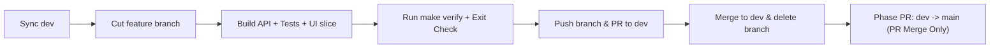
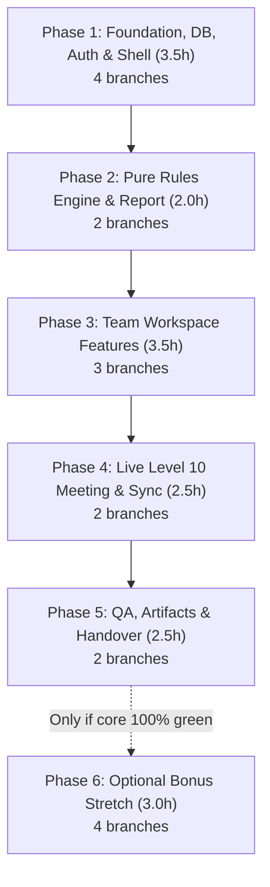

# Phase-Wise Feature Branch Development Plan: Level 10 Meeting Platform

**Status:** Execution Plan (Source of Truth for Git Workflow & Delivery)  
**Target Effort:** ~14.0 hours core (Phases 1–5) + optional stretch (Phase 6)  
**Branching Model:** GitFlow-Lite (`feature/*` → `dev` → PR merge only → `main`; direct pushes to `main` are forbidden)  
**Related Docs:** [`PRD.md`](./PRD.md) · [`JIRA-PLAN.md`](./JIRA-PLAN.md) · [`DESIGN_SYSTEM.md`](./DESIGN_SYSTEM.md) · [`SIMPLIFIED.md`](./SIMPLIFIED.md)

---

## 1. GitHub Feature Branch & PR Governance

Every piece of work is developed on its own short-lived feature branch cut from `dev`, integrated into `dev`, and promoted from `dev` into `main` **exclusively via Pull Request merge on GitHub**.

### Branching Rules

1. **`main` is Pull-Request Merge Only (Protected):** Never commit or push directly to `main`. `main` only receives changes through GitHub Pull Requests (`dev` → `main`), enforced by `AGENTS.md`, `.agents/rules/git-branching.md`, and the local `.git/hooks/pre-push` guard.
2. **`dev` is the Active Integration & Push Branch:** Cut every feature branch off `dev`, push feature branches / integrate into `dev`, and open a PR from `dev` → `main` at the end of each phase (or verified milestone).
3. **One Feature = One Branch:** Every feature below has an exact branch name following `<type>/p<phase>-<feature-slug>` (`chore/`, `feat/`, `test/`, `docs/`).
4. **Conventional Commits with Story Keys:** Prefix commits cleanly, e.g. `feat(scorecard): add atomic make-it-an-issue endpoint (E5-S3)`.
5. **Delete merged branches:** After merging a feature PR into `dev`, delete the feature branch so history stays clean and readable for evaluators.

### Standard Workflow for Every Feature Branch



```bash
# 1. Start every feature from an up-to-date dev
git checkout dev && git pull origin dev
git checkout -b <branch-name>

# 2. Build, test, and run the compulsory quality gate (from Phase 1 onward)
make verify

# 3. Commit, push feature branch, and open PR into dev (NEVER push directly to main)
git add -A
git commit -m "<type>(<scope>): <summary> (<E#-S#>)"
git push -u origin <branch-name>
```

### Mandatory Pre-PR Self-Review Checklist (Every Branch)

- [ ] Respects all `AGENTS.md` invariants (Clock-only time, `Decimal` + `ROUND_HALF_UP`, centralized RBAC dependency, zero business logic in React)
- [ ] Server-side role & team-boundary enforcement verified on any new/modified endpoint
- [ ] PostgreSQL constraints & Pydantic validation cover new inputs/entities
- [ ] Automated tests added for the feature and `make verify` passes with 0 errors
- [ ] OpenAPI `/docs` accurately reflects request/response schemas and `{code, message, fields?}` errors
- [ ] `docker compose up` still starts cleanly from a fresh volume
- [ ] Short AI-usage note recorded (what AI drafted vs. what was verified/edited by hand) for the README

---

## 2. High-Level Phase & Branch Map



| Phase | Branches | Est. Hours | Milestone Outcome |
| --- | --- | ---: | --- |
| **Phase 1: Foundation, Data, Auth & Shell** | `1.1` → `1.4` | 3.5 h | Monorepo boots via `docker compose up`, Postgres constraints & idempotent seed work, RBAC enforced, Next.js header & switchers live |
| **Phase 2: Pure Rules Engine & Report** | `2.1` → `2.2` | 2.0 h | 100% pure-Python rules pass every boundary test; `make report` matches hand-verified ground truth at default & alternate `APP_NOW` dates |
| **Phase 3: Team Workspace Features** | `3.1` → `3.3` | 3.5 h | Complete Team Page (Scorecard + atomic Make it an Issue, Issues + Solve + Add To-Do, To-Dos + 90% target, read-only Rocks) |
| **Phase 4: Live Level 10 Meeting & Sync** | `4.1` → `4.2` | 2.5 h | Full synchronized Level 10 meeting across 2+ browsers (≤1s WS sync + polling fallback, server timer, Conclude ratings, immutable Summary) |
| **Phase 5: QA, Artifacts & Handover** | `5.1` → `5.2` | 2.5 h | Full unattended `make test` + `make verify`, Markdown test report, failure trace artifact, ≤2-page README, 1-page `DECISIONS.md`, ≤7-min video |
| **Phase 6: Optional Bonus (Stretch)** | `6.1` → `6.4` | 3.0 h | Extra Issue sources, optimistic locking, audit trail, 1,000-company scale note (only after Phase 5 passes) |

---

## 3. Phase 1 — Foundation, Data Integrity, Auth & App Shell (3.5 h)

### Branch 1.1 — `chore/p1-monorepo-scaffold`
- **Jira / PRD Refs:** `E1-S1`, `E1-S2`, `E1-S3` · `NFR-04`, `NFR-05`
- **Estimate:** 1.0 h
- **Depends On:** None (first branch off `dev`)
- **Scope:**
  - Create lightweight polyglot monorepo layout (`apps/api/`, `apps/web/`, `e2e/`, `docs/test/`, `artifacts/`) without heavy orchestrators (no Turborepo/Nx).
  - Copy starter `seed.json` to `apps/api/seed/seed.json`.
  - Author root `AGENTS.md` (1-page non-negotiable engineering invariants: Clock-only time, `Decimal` half-up rounding, centralized RBAC, zero business logic in React, compulsory `make verify`).
  - Create self-documenting root `Makefile` (`help`, `up`, `down`, `seed`, `report`, `test`, `verify`, `ports`).
  - Create `docker-compose.yml` (`db` Postgres 16, `api` FastAPI, `web` Next.js) with healthchecks gating startup order, plus `.env.example` (`APP_NOW=2026-11-11T15:00:00Z`).
  - Implement `apps/api/app/clock.py` (`LiveClock` with monotonic elapsed time for the running API; `FrozenClock` with zero elapsed offset + `.advance()` for `make report` and tests) and `/api/health`.
- **Tests Added:**
  - Clock unit tests (default `APP_NOW`, monotonic tick, frozen zero-offset, manual `.advance()`).
  - Static grep/lint guard verifying `datetime.now()` / `date.today()` are never called outside `clock.py`.
- **Exit Check (Before PR Merge):**
  - `docker compose up --build` starts Postgres, API, and Web cleanly from an empty volume.
  - `GET http://localhost:8000/api/health` returns `200`.
  - `make help`, `ruff check`, and `tsc --noEmit` succeed with 0 errors.

### Branch 1.2 — `feat/p1-db-schema-and-seed`
- **Jira / PRD Refs:** `E2-S1`, `E2-S2`, `E2-S3` · `NFR-03`, `PRD §7`, `PRD §9`
- **Estimate:** 1.25 h
- **Depends On:** `chore/p1-monorepo-scaffold`
- **Scope:**
  - Define SQLAlchemy 2 ORM models in `apps/api/app/models/`: `companies`, `teams`, `users`, `memberships`, `measurables`, `scores`, `rocks`, `milestones`, `issues`, `todos`, `meetings`, `meeting_attendees`, `meeting_ratings`, `meeting_summaries`.
  - Use `NUMERIC` for score/goal values (never `FLOAT`), `TIMESTAMPTZ` for UTC instants, and `DATE` for `week_start`/`due_date`.
  - Add PostgreSQL `CHECK` constraints (roles, priority `1..5`, rating `1..10`, non-empty title, non-empty resolution note when solved, goal shape per `goal_type`, rock seeded status, meeting section) and unique constraints (`scores(measurable_id, week_start)`, `memberships(user_id, team_id)`, `meeting_attendees(meeting_id, user_id)`, `meeting_ratings(meeting_id, user_id)`).
  - Add both partial unique indexes:
    1. `UNIQUE (source_measurable_id, source_week_start) WHERE solved_at IS NULL AND source_measurable_id IS NOT NULL`
    2. `UNIQUE (team_id) WHERE ended_at IS NULL`
  - Create initial Alembic migration `0001_initial_schema.py` and wire automatic migration + seed execution in API container entrypoint.
  - Build idempotent `apps/api/app/cli/seed.py` preserving all seed IDs (`u1`, `m1`, `t12`, etc.), deriving `mt1`/`mt2` `scorecard_week` from `started_at`, and matching seeded `issues_solved`/`todos_created` via `started_at <= ts <= ended_at`.
- **Tests Added:**
  - `apps/api/tests/test_db_constraints.py`: raw DB inserts proving Postgres rejects invalid priority, rating out of 1–10, bad goal shape, duplicate scores, duplicate unsolved source Issues, and two concurrent active meetings per team.
  - Idempotent seed verification test confirming exact row counts after running `seed.py` twice in a row (1 company, 3 teams, 9 users, 11 memberships, 7 measurables, 83 scores, 7 rocks, 12 milestones, 9 issues, 20 todos, 2 meetings).
- **Exit Check (Before PR Merge):**
  - Fresh volume `docker compose up` migrates and seeds automatically.
  - Running `make seed` twice leaves identical row counts with 0 errors.
  - `pytest apps/api/tests/test_db_constraints.py` passes 100%.

### Branch 1.3 — `feat/p1-auth-rbac-and-errors`
- **Jira / PRD Refs:** `E3-S1`, `E3-S2`, `E3-S3` · `FR-01`, `FR-02`, `NFR-01`, `NFR-02`, `NFR-06`
- **Estimate:** 0.75 h
- **Depends On:** `feat/p1-db-schema-and-seed`
- **Scope:**
  - Implement signed HMAC/JWT session tokens (`apps/api/app/auth/tokens.py`).
  - Build endpoints under `/api/v1`:
    - `GET /auth/users` (lists seeded personas for the user switcher)
    - `POST /auth/login` (accepts seeded `user_id` or `email`, returns signed token + user profile)
    - `GET /me` (returns authenticated user + role)
    - `GET /teams` (returns user's teams; all 3 teams for Admin `u1`)
  - Implement single centralized authorization dependency (`apps/api/app/auth/deps.py`):
    - `require_team_read`: Admin passes for all existing teams (even without membership rows in `team_sales`/`team_ops`); non-member gets `404 Not Found` (no ID leakage).
    - `require_team_write`: calls `require_team_read`, then refuses `observer` with `403 Forbidden`.
    - Helper to validate eligible To-Do owners: `(all company Admins) ∪ (team's Team Members)`.
  - Register global FastAPI exception handlers returning unified `{code, message, fields?}` JSON envelope for `401`, `403`, `404`, `409`, `422`.
- **Tests Added:**
  - Auth & RBAC unit/API tests (`401` missing/bad token, `u6` gets `404` on `team_lead`, `u5` gets `403` on write probes, `u1` accesses all 3 teams, unified error envelope verified).
- **Exit Check (Before PR Merge):**
  - OpenAPI `/docs` shows all auth/team endpoints and error schemas.
  - All auth/RBAC tests pass.

### Branch 1.4 — `feat/p1-web-shell-and-switchers`
- **Jira / PRD Refs:** `E9-S1` · `FR-01`, `FR-02`, `NFR-09`, `NFR-10`, `DESIGN_SYSTEM.md`
- **Estimate:** 0.5 h
- **Depends On:** `feat/p1-auth-rbac-and-errors`
- **Scope:**
  - Configure Next.js (App Router, TypeScript strict), Tailwind CSS, Inter font, Lucide React, TanStack Query, React Hook Form + Zod, and `DESIGN_SYSTEM.md` CSS custom properties (`#2563EB`, `#0F172A`, `#F8FAFC`, semantic tokens).
  - Install/build reusable `shadcn/ui` primitives (`Button`, `Badge`, `Card`, `Dialog`, `Input`, `Select`, `Table`, `Tabs`).
  - Build typed API client (`apps/web/src/lib/api.ts`) attaching the Bearer token and normalizing `{code, message, fields}` errors.
  - Build `AppHeader` (64px sticky): `Level 10` brand, **Team Switcher**, **Start / Join Meeting CTA** slot, and **Seeded User Switcher** (showing user name + role pill).
  - Create the two-page shell: Team Page (`/`) with section tabs/rail (`Scorecard`, `Issues`, `To-Dos`, `Rocks`) + Observer read-only banner, plus `403`/`404` fallback states.
- **Tests Added:**
  - Zero-error TypeScript check (`tsc --noEmit`) and production `next build` check.
- **Exit Check (Before PR Merge):**
  - Switching between `u1`, `u2`, `u5`, `u6` in the browser dynamically updates visible teams and role badge.
  - Visiting an unauthorized team shows a clean error state (never leaks data).

---

## 4. Phase 2 — Pure Business Rules Engine & Rules Report (2.0 h)

### Branch 2.1 — `feat/p2-pure-rules-engine`
- **Jira / PRD Refs:** `E4-S1`, `E4-S2`, `E4-S3`, `E4-S4`, `E4-S5`, `E10-S1` · `BR-01` to `BR-60`
- **Estimate:** 1.5 h
- **Depends On:** `feat/p1-db-schema-and-seed`
- **Scope:**
  - Build pure-Python `apps/api/app/rules/` with **zero** FastAPI or SQLAlchemy imports:
    - `time_utils.py`: `ZoneInfo("America/Chicago")`, `week_start_of(ts)` (DST-safe across Nov 1, 2026), `last_13_weeks(now)`, `today_in_tz(now)`, `quarter_of(date)`, `round_half_up_int`, `round_half_up_1dp` via `Decimal` (`ROUND_HALF_UP`).
    - `scorecard.py`: `at_least`, `at_most`, `between`, `exactly` (boundaries on track; missing closed week → `off_track`; missing current week → `pending`; present current week evaluated against goal).
    - `todos.py`: completion rate per week (done by end of due week in `America/Chicago`; late counts as not done; 0 due → `None`; exact `done * 10 >= due * 9` for `meets_target`; half-up whole percent) and overdue check (`done_at is None and due_date < today`).
    - `rocks.py`: computed status (`complete` → `off_track` if seeded off-track or any unfinished Milestone has `due_date < today` → else `on_track`) and half-up progress percent (no Milestones: `0%`, or `100%` if complete).
    - `issues.py`: unsolved order (priority 5→1, oldest `created_at` first within priority, `None` priority last).
    - `meetings.py`: rating average to 1 decimal half-up (excluding non-raters; `None` if no ratings), `scorecard_week` derivation, and summary builder.
- **Tests Added:**
  - `apps/api/tests/test_rules.py`: exhaustive boundary suite covering every rule and seed trap (`m2` 3.0, `m3` 2/4/4.5, `m4` 0/2, `m5` Oct 19/Nov 2 missing + Nov 9 present, `t11`/`t28`/`t29` DST boundaries, exact 90% vs 89.6% rounding trap, current week non-null `2026-11-09`, `t12`/`t31` vs `t30` due today, `ms2` due today, `r2` off-track + `12.5% → 13%`, `r3` 0-milestone `100%`, `r4`/`r5`/`r7` `0%`, `i2` before `i1`, `i4` null last, `mt1` excludes `t22`, `mt2` `8.25 → 8.3`).
  - Import-purity test asserting `apps/api/app/rules` never imports `fastapi` or `sqlalchemy`.
- **Exit Check (Before PR Merge):**
  - `pytest apps/api/tests/test_rules.py` 100% green.

### Branch 2.2 — `feat/p2-rules-report-cli`
- **Jira / PRD Refs:** `E4-S6` · `NFR-04`, `Deliverable 3`
- **Estimate:** 0.5 h
- **Depends On:** `feat/p2-pure-rules-engine`
- **Scope:**
  - Implement `apps/api/app/rules/report.py` and `apps/api/app/cli/report.py` using `FrozenClock(APP_NOW)` (zero elapsed offset so `"now"` prints exact `APP_NOW`).
  - Match the exact starter `README.md` JSON schema:
    - Top-level `now` + `teams.<team_id>`
    - Nested `teams.<team_id>.meetings` (`{}` for teams with no ended meetings)
    - All 13 weeks in `measurable_status` and `todo_completion`
    - Current-quarter `rocks`
    - Plain-string sorted ID lists (`overdue_todos`, `issues_solved`, `todos_created`, `attendee_ids`) and Issue-ordered `issue_order`
  - Wire `make report` and commit generated `rules_report.json` at repo root.
- **Tests Added:**
  - Snapshot/assertion test verifying `generate_rules_report` against every hand-verified checkpoint at `2026-11-11T15:00:00Z`, plus alternate `APP_NOW` tests (`2026-11-12T15:00:00Z` where `t30` becomes overdue and `r1` turns off-track; `2026-11-16T15:00:00Z` where `2026-11-09` closes).
- **Exit Check (Before PR Merge):**
  - `make report` matches committed `rules_report.json` byte-for-byte.
  - Every single team, metric, rock, todo week, issue order, and seeded meeting (`mt1`, `mt2`) verified by hand.

---

## 5. Phase 3 — Team Workspace Features (API + Reusable UI) (3.5 h)

### Branch 3.1 — `feat/p3-scorecard`
- **Jira / PRD Refs:** `E5-S1`, `E5-S2`, `E5-S3`, `E5-S4` · `FR-10`, `FR-11`, `FR-12`, `BR-10`, `BR-60`
- **Estimate:** 1.5 h
- **Depends On:** `feat/p1-web-shell-and-switchers`, `feat/p2-pure-rules-engine`
- **Scope:**
  - **API (`apps/api/app/routers/scorecard.py` + `services/scorecard.py`):**
    - `GET /api/v1/teams/{id}/scorecard`: all team Measurables with 13 weeks ending at current week, owner, goal, unit, score, computed status, and any existing unsolved linked Issue ID.
    - `PUT /api/v1/teams/{id}/measurables/{mid}/scores/{week}`: `NUMERIC` upsert (last-save-wins), returns updated cell & status; Observers refused (`403`); non-numeric rejected (`422`).
    - `POST /api/v1/teams/{id}/issues/from-measurable`: validates cell is `off_track` (else `422`), formats title `"<Measurable name>, week of <Mon D>"`, executes atomic `INSERT ... ON CONFLICT DO NOTHING RETURNING id` + `SELECT` on partial unique index; returns `201` on create or `200` with existing unsolved Issue (`i5` for `m1`/`2026-11-02`); creates new for `m4`/`2026-10-26` despite solved `i6`.
  - **UI (`apps/web/src/components/sections/ScorecardSection.tsx`):**
    - Reusable component designed for both Team Page and Live Meeting Page (`highlightWeek` prop for last closed week).
    - Sticky Measurable column, 13 horizontally scrollable weekly columns, `tabular-nums` values, semantic badge + text label (never color alone), inline edit with optimistic update & rollback, "Make it an Issue" action on off-track cells, strictly read-only for Observers.
- **Tests Added:**
  - API tests for 13-week grid, inline edit, Observer `403`, non-off-track `422`, `i5` returning `200`, `m4`/`2026-10-26` returning `201` despite solved `i6`, and **20 concurrent Make it an Issue requests returning exactly 1 Issue ID**.
- **Exit Check (Before PR Merge):**
  - Inline score edits recalculate status immediately and persist on reload.
  - Concurrency test (20 parallel calls) passes 100%.

### Branch 3.2 — `feat/p3-issues-and-todos`
- **Jira / PRD Refs:** `E6-S1`, `E6-S2`, `E6-S3`, `E6-S4` · `FR-20` to `FR-31`, `BR-20`, `BR-40`
- **Estimate:** 1.5 h
- **Depends On:** `feat/p3-scorecard`
- **Scope:**
  - **API (`routers/issues.py`, `routers/todos.py`):**
    - `GET /api/v1/teams/{id}/issues`: unsolved Issues in Issue order + solved Issues separately (with `solved_at` & `resolution_note`) + source Measurable/week metadata.
    - `POST /api/v1/teams/{id}/issues`: create Issue (title required, optional priority `1..5`, owner = creator).
    - `PATCH /api/v1/issues/{id}`: update priority (`1..5` or `null`), resolves team before RBAC check.
    - `POST /api/v1/issues/{id}/solve`: requires non-empty `resolution_note` (`422` if blank), sets `solved_at = clock.now()`.
    - `POST /api/v1/issues/{id}/todos`: create To-Do linked to Issue; validates owner ∈ `(all company Admins) ∪ (team's Team Members)` (`422` for Observers or other teams' members); sets `due_date = today(company_tz) + 7 days`; tags active `meeting_id` if team has an active meeting.
    - `GET /api/v1/teams/{id}/todos`: lists To-Dos with owner, due date, `done_at`, source Issue, `is_overdue`, eligible owners list, and last closed week's completion rate (with `meets_target`).
    - `PATCH /api/v1/todos/{id}`: toggle done (`done_at = clock.now()`) or undo (`done_at = None`).
  - **UI (`IssuesSection.tsx`, `TodosSection.tsx`):**
    - Reusable `<IssuesSection />` (shared with Meeting Page): unsolved ordered list, priority selector, source badge, Solved Issues tab, Create Issue dialog, Solve Issue dialog (required resolution note), Add To-Do dialog (owner dropdown filtered to eligible Admins + Team Members, due date shown as `today + 7 days`).
    - `<TodosSection />`: compact table, overdue badges, immediate done checkbox + undo, last closed week completion rate vs. 90% target indicator.
- **Tests Added:**
  - API tests for Issue order, solve blank-note `422`, `u1` assignable as owner on `team_sales`/`team_ops`, Observer (`u5`) & cross-team (`u6`) rejected as owner (`422`), To-Do toggle/undo, Observer write `403`, non-member `404` on `/issues/{id}` and `/todos/{id}`.
- **Exit Check (Before PR Merge):**
  - Full Team Page flow (Create Issue → Prioritize → Add To-Do → Solve Issue → Complete/Undo To-Do) works cleanly for `u2` and `u1` and is read-only for `u5`.

### Branch 3.3 — `feat/p3-rocks`
- **Jira / PRD Refs:** `E7-S1`, `E7-S2` · `FR-40`, `BR-30`, `BR-31`
- **Estimate:** 0.5 h
- **Depends On:** `feat/p1-web-shell-and-switchers`, `feat/p2-pure-rules-engine`
- **Scope:**
  - **API (`routers/rocks.py`):** `GET /api/v1/teams/{id}/rocks` returning current-quarter Rocks (`quarter_of(clock.now())`) with owner, computed status, half-up progress percent, and ordered Milestones (`due_date`, `done`, `is_past_due`).
  - **UI (`RocksSection.tsx`):** Read-only expandable Rock cards/rows with progress bar, semantic status badge + label, and Milestone list highlighting past-due unfinished Milestones (`ms5` on `r2`).
- **Tests Added:**
  - API tests verifying `r1` (`on_track`, `33%`, `ms2` not past due), `r2` (`off_track`, `13%`, `ms5` past due), `r3` (`complete`, `100%`), `r6` (`0%`), and team boundary `404`.
- **Exit Check (Before PR Merge):**
  - Rocks UI matches `rules_report.json` values and has zero mutation controls.

---

## 6. Phase 4 — Live Level 10 Meeting & Real-Time Sync (2.5 h)

### Branch 4.1 — `feat/p4-meeting-lifecycle-and-timer`
- **Jira / PRD Refs:** `E8-S1`, `E8-S2`, `E8-S6` · `FR-50` to `FR-53`, `FR-56`, `FR-57`, `BR-50`
- **Estimate:** 1.25 h
- **Depends On:** `feat/p3-issues-and-todos`
- **Scope:**
  - **API (`routers/meetings.py` + `services/meetings.py`):**
    - `POST /api/v1/teams/{id}/meetings`: Admin or Team Member starts a meeting, becomes facilitator, sets `section = 'scorecard'`, `section_started_at = now`, `scorecard_week = last_closed_week`, records facilitator in `meeting_attendees`; returns `409` if team already has an active meeting; Observers refused (`403`).
    - `GET /api/v1/teams/{id}/meetings/active` & `GET /api/v1/meetings/{id}`: returns server-owned state (`section`, `allotted_seconds` 300/3600/600, `remaining_seconds`, `over_time`, `attendees`, `ratings`, `todos_created`).
    - `POST /api/v1/meetings/{id}/join`: any team reader (including Observers) joins; upserts persistent `meeting_attendees` row.
    - `POST /api/v1/meetings/{id}/advance` & `POST /api/v1/meetings/{id}/end`: **facilitator-only** (`403` for everyone else, including Admin if not facilitator), allowed at any time (no auto-advance on overrun). On end, writes immutable JSONB snapshot into `meeting_summaries` inside the same DB transaction.
    - `PUT /api/v1/meetings/{id}/rating`: attending Admin/Team Member submits/updates rating `1..10` until meeting ends (`403` Observer, `409` ended meeting, `422` out of range).
    - `GET /api/v1/meetings/{id}/summary`: returns immutable summary for any ended meeting, including seeded `mt1` and `mt2`.
- **Tests Added:**
  - API tests for start, `409` duplicate active meeting, Observer join allowed / start & rate refused (`403`), facilitator-only advance/end, timer overrun (`clock.advance(400)` sets `over_time=True` without advancing section), rating update & `409` after end, and summary parity for `mt1`, `mt2`, and a newly ended meeting (proving later score edits don't alter its summary).
- **Exit Check (Before PR Merge):**
  - All meeting lifecycle & summary API tests pass 100%.

### Branch 4.2 — `feat/p4-meeting-ws-and-live-ui`
- **Jira / PRD Refs:** `E8-S3`, `E8-S4`, `E8-S5` · `FR-54`, `FR-55`, `FR-56`, `FR-57`, `NFR-07`, `NFR-09`
- **Estimate:** 1.25 h
- **Depends On:** `feat/p4-meeting-lifecycle-and-timer`
- **Scope:**
  - **Real-Time Hub (`apps/api/app/realtime/hub.py`):**
    - `WS /api/v1/meetings/{id}/ws?token=...`: authenticates token & checks `require_team_read`; upserts persistent `meeting_attendees` row; tracks live connected socket presence separately; immediately sends full meeting state snapshot on connect/reconnect.
    - Broadcasts compact state/invalidation events on advance, end, join, leave, rating, and any score/Issue/To-Do mutation for that team while a meeting is active.
  - **Frontend (`apps/web/src/lib/ws.ts`, `apps/web/src/app/meetings/[id]/page.tsx`, `components/meeting/*`):**
    - Reconnecting WebSocket hook with connection status indicator (`Connected` green / `Reconnecting` amber / `Connection Lost` red) + automatic TanStack Query 2s polling fallback when disconnected.
    - Wire Header "Start Meeting" / "Join Live Meeting" CTA on the Team Page.
    - Build distraction-free **Live Meeting Page** (`/meetings/[id]`):
      - `AgendaBar` (`Scorecard 5m → IDS 60m → Conclude 10m`) + giant `tabular-nums` `MeetingTimer` (turns red/over-time on overrun) + Attendee pills (persistent + live dot) + facilitator-only Advance/End controls.
      - `scorecard` section mounts reused `<ScorecardSection />` highlighting `meeting.scorecard_week`.
      - `ids` section mounts reused `<IssuesSection />` with all actions.
      - `conclude` section renders `<ConcludeSection />` (meeting's newly created To-Dos + 1–10 rating buttons editable until End; read-only for Observers).
      - `ended` state renders `<MeetingSummary />` (last closed week Measurable statuses, Issues solved, To-Dos created, attendees, average rating).
- **Tests Added:**
  - FastAPI WebSocket integration test verifying snapshot on connect, broadcast on advance, and unauthorized WS rejection.
- **Exit Check (Before PR Merge):**
  - Manual two-browser test (`u2` facilitator + `u3`/`u5` attendee): advancing sections, editing scores, solving Issues, adding To-Dos, rating, and ending syncs within ≤1s, and refreshing either tab restores exact state.

---

## 7. Phase 5 — Hardening, Verification Suite, Artifacts & Handover (2.5 h)

### Branch 5.1 — `test/p5-api-e2e-and-test-driver`
- **Jira / PRD Refs:** `E10-S2`, `E10-S3`, `E10-S4` · `NFR-08`, `PRD §10`
- **Estimate:** 1.5 h
- **Depends On:** `feat/p4-meeting-ws-and-live-ui`
- **Scope:**
  - Complete `apps/api/tests/test_api.py` covering every route in the RBAC matrix, input validation (`422`), `i5`/`i6` deduplication, and 20x parallel Make it an Issue concurrency.
  - Build Playwright E2E suite (`e2e/tests/live-meeting.spec.ts`):
    - Two independent browser contexts (`u2` facilitator + `u3` attendee) in one meeting: facilitator starts meeting, Browser 2 joins, facilitator advances Scorecard → IDS → Conclude → End, Browser 2 updates within 2 seconds at every transition and sees the final Summary.
    - Reconnect/reload assertion proving Browser 2 recovers live section & timer after page refresh.
  - Create strictly local unattended runner (`docs/test/run-all.py`) invoked by `make test`:
    - Enforces `localhost`/`127.0.0.1` URLs only.
    - Waits on `/api/health` and web readiness.
    - Runs `pytest` (rules + DB constraints + API) and Playwright E2E against a freshly seeded schema with frozen `APP_NOW`.
    - Emits `docs/test/report/latest-test-report.md` (git branch/SHA, pass/fail summary, duration, step log).
  - Write `docs/test/README.md` (required short note on fixture & clock strategy + how to open `artifacts/failure-trace.zip`).
  - Write `docs/test/manual/walkthrough.md` (1-page persona test script for evaluator & Loom recording).
  - Deliberately trigger one failing Playwright run with `--trace on`, commit the real trace to `artifacts/failure-trace.zip`, and revert the intentional failure.
  - Add lightweight `.github/workflows/ci.yml` running lint, typecheck, and automated tests.
- **Exit Check (Before PR Merge):**
  - `make test` and `make verify` pass 100% unattended from a clean DB.
  - `docs/test/report/latest-test-report.md` shows 100% PASS.
  - `artifacts/failure-trace.zip` verified readable with `npx playwright show-trace artifacts/failure-trace.zip`.

### Branch 5.2 — `docs/p5-readme-decisions-and-handover`
- **Jira / PRD Refs:** `E11-S1`, `E11-S2`, `E11-S3`, `E11-S4`, `E11-S5` · `Deliverables 1–5`
- **Estimate:** 1.0 h
- **Depends On:** `test/p5-api-e2e-and-test-driver`
- **Scope:**
  - Write root `README.md` (**≤ 2 pages**): quickstart (`docker compose up`), test command (`make test`), verify command (`make verify`), report command (`make report`), OpenAPI link, assumptions, known limitations, link to `docs/test/README.md` & `artifacts/failure-trace.zip`, and authentic section on AI tools used and what was verified by hand.
  - Write root `DECISIONS.md` (**1 page**): crisp Decision + Tradeoffs + Why for all 5 required topics (data model & source links, API design, real-time transport & state recovery, duplicate-free Make it an Issue, immutable past meeting summaries).
  - Remove private recruiter brief directory (`Assignment - Senior AI First Engineer/`) before making the repository public (seed remains at `apps/api/seed/seed.json`).
  - Record walkthrough video (**≤ 7 minutes**, Loom or unlisted YouTube) showing two browsers in one live meeting, core weekly journey, `make report` / `make test`, main decisions, and AI workflow.
- **Exit Check (Final Submission Gate):**
  - Fresh clone in `/tmp/cadence-verify`: `docker compose up --build -d`, `make verify`, `make test`, `make report` (0 diff vs. committed `rules_report.json`), and `APP_NOW=2026-11-16T15:00:00Z make report` all pass cleanly.
  - Every submission link (public GitHub repo, unlisted video) opens cleanly in an Incognito browser window without requesting access.

---

## 8. Phase 6 — Optional Bonus Branches (Stretch Only After Phase 5 Passes)

Only start these if Phases 1–5 are 100% green, verified on a fresh clone, and time remains:

| Branch | Jira / PRD Ref | Scope | Est. |
| --- | --- | --- | ---: |
| `feat/p6-bonus-rock-todo-issues` | `E12-S1` (`FR-60`) | Generalize Make it an Issue source key for off-track Rocks and overdue To-Dos with the same partial-unique duplicate-free guarantee + concurrency tests | 1.0 h |
| `feat/p6-bonus-optimistic-locking` | `E12-S2` (`FR-61`) | Add `version` column + `expected_version`/`If-Match` check on score updates and Issue priority (`409` on conflict + UI conflict banner) | 0.75 h |
| `feat/p6-bonus-audit-trail` | `E12-S3` (`FR-62`) | Append-only `audit_logs` table recording who changed what and when for scores, Issues, and To-Dos + read endpoint | 0.75 h |
| `docs/p6-bonus-1000-companies-scale` | `E12-S4` | Add concise scaling paragraph to `DECISIONS.md` (tenant key, Postgres RLS/partitioning, composite indexes, Redis / `LISTEN/NOTIFY` WebSocket fan-out) | 0.5 h |

---

## 9. Branch-to-Rubric Traceability Matrix

| Evaluation Area | Weight | Branches Directly Proving 100% Mastery |
| --- | ---: | --- |
| **Data model & API design** | 20% | `feat/p1-db-schema-and-seed`, `feat/p1-auth-rbac-and-errors`, `feat/p3-scorecard`, `feat/p3-issues-and-todos`, `feat/p3-rocks`, `feat/p4-meeting-lifecycle-and-timer` |
| **Real-time, concurrency & rule correctness** | 20% | `feat/p2-pure-rules-engine`, `feat/p2-rules-report-cli`, `feat/p3-scorecard`, `feat/p4-meeting-lifecycle-and-timer`, `feat/p4-meeting-ws-and-live-ui` |
| **Usability** | 15% | `feat/p1-web-shell-and-switchers`, `feat/p3-scorecard`, `feat/p3-issues-and-todos`, `feat/p3-rocks`, `feat/p4-meeting-ws-and-live-ui` |
| **Security** | 15% | `feat/p1-auth-rbac-and-errors`, `feat/p3-issues-and-todos`, `feat/p4-meeting-lifecycle-and-timer`, `test/p5-api-e2e-and-test-driver` |
| **Testing** | 15% | `feat/p1-db-schema-and-seed`, `feat/p2-pure-rules-engine`, `feat/p3-scorecard`, `test/p5-api-e2e-and-test-driver` |
| **Frontend code quality** | 10% | `chore/p1-monorepo-scaffold`, `feat/p1-web-shell-and-switchers`, `feat/p3-scorecard`, `feat/p3-issues-and-todos`, `feat/p4-meeting-ws-and-live-ui` |
| **Documentation & video** | 5% | `chore/p1-monorepo-scaffold` (`AGENTS.md`), `test/p5-api-e2e-and-test-driver` (`docs/test/*`), `docs/p5-readme-decisions-and-handover` |
